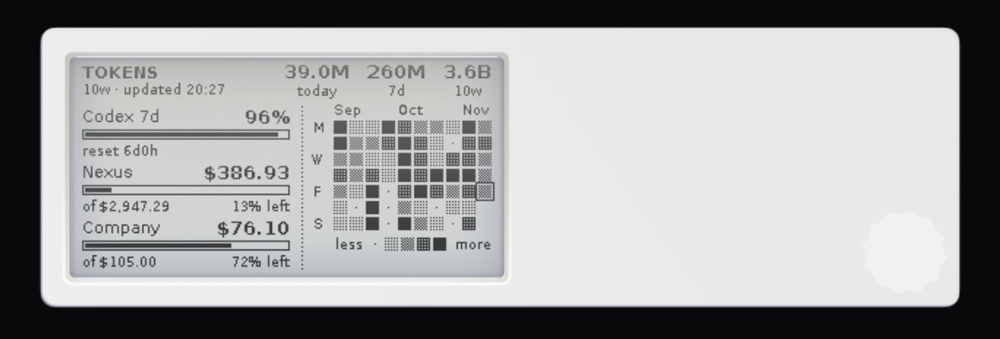
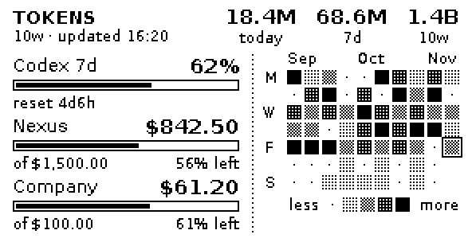
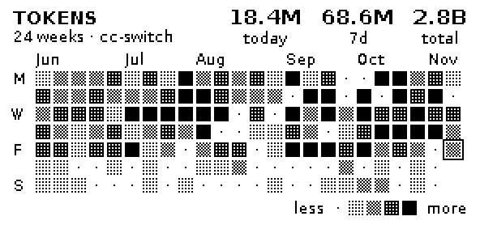
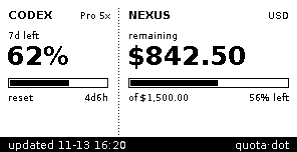

# quota-dot

把 AI 编程工具的额度和用量画成黑白图，定时推到 [Dot. Quote/0](https://dot.mindreset.tech) 墨水屏上。

- **额度**：Codex 剩余额度、中转站余额（Nexus、公司 LiteLLM 团队）
- **用量**：本机 [cc-switch](https://github.com/farion1231/cc-switch) 记录的每日 token 用量，画成 GitHub 式格子图

屏幕是 296×152、只有黑白两色，深浅用点阵模拟。



## 效果

上图是 overview 页面推送后，在 Dot. App 里看到的设备预览。下面三张是各个页面的渲染图，用示例数据生成，放大 2 倍（`python3 scripts/make_screenshots.py` 重新生成）。

**overview**：顶部是今天、近 7 天、近 10 周的 token 合计；左边每个额度一行，右边是最近几周的每日用量。



**heatmap**：近 24 周的每日用量格子图。



**quota**：只看额度，左边 Codex，右边中转站。



## 运行

```bash
pip install -r requirements.txt
cp .env.example .env        # 填 Dot. API Key、设备序列号，以及要用的数据源
```

```bash
python -m quotadot list     # 看有哪些数据源和页面、这台机器上能不能用
```

```bash
python -m quotadot render   # 只出图到 out/，不推送，用来预览
```

```bash
python -m quotadot push     # 出图并推送一次
```

```bash
python -m quotadot run      # 常驻，每个页面按自己的间隔推送
```

推送前，在 Dot. App 的「内容工坊」里给设备的循环列表加「图片 API」项，每个页面一个。用多个页面时，把各项的 key 填到 `PAGE_<页面名>_TASK_KEY`，否则它们会推到同一项，互相覆盖。

格子图读的是本机的 cc-switch 数据库，所以要在装了 cc-switch 的 Mac 上跑。在 Mac 上常驻运行（登录后自动启动），用这条命令安装：

```bash
./deploy/install-launchd.sh
```

只推额度的话，也可以用 Docker 部署到服务器上，见 [docs/configuration.md](docs/configuration.md)。

## 修改

所有设置都在 `.env` 里，不用改代码：

| 想改什么 | 改哪里 |
| --- | --- |
| 推哪些页面 | `PAGES=overview,heatmap` |
| 推送间隔 | `PAGE_<页面名>_INTERVAL`，单位秒 |
| overview 显示几周 | `PAGE_OVERVIEW_WEEKS`，4 到 13 |
| 格子按什么统计 | `PAGE_<页面名>_METRIC=tokens`（含缓存）、`fresh`（只算输入加输出）或 `cost`（花费） |
| 中转站 | `NEXUS_*`、`COMPANY_*`，或者用 `RELAYS` 写一个 JSON 列表 |

要加新功能，就往插件目录放一个文件，别的地方都不用改：

```
quotadot/
  sources/   数据源：codex.py  relays.py  ccswitch.py
  pages/     页面：overview.py  heatmap.py  quota.py
  widgets.py 页面共用的组件：TOKENS 标题、格子图、额度行
  draw.py    画图工具：字体、进度条、文字截断、底栏
```

- **新页面**：在 `pages/` 里写一个继承 `Page` 的类，加上 `@page`，实现 `render()`。
- **新数据源**：在 `sources/` 里写一个继承 `Source` 的类，加上 `@source`，实现 `fetch()`。
- **新的中转站类型**：在 `sources/relays.py` 里写一个函数，加上 `@relay_type`。

完整的配置项、每个数据源的取数方式、新页面的示例代码和部署步骤，见 [docs/configuration.md](docs/configuration.md)。
